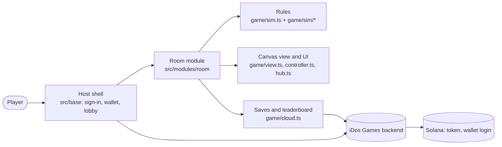

# Into the Delve

A turn-based dungeon crawler where every enemy attack is painted on the floor before it lands, so
each room is a small tactics puzzle you read and solve one step at a time.

**Play:** https://h406pwm7.idos.games/ · [iDos Games catalog](https://idosgames.com/app/H406PWM7/)

## Team

- **Erlan** ([hexusArgon](https://github.com/hexusArgon)) — game design. Code is written with AI
  agents on the iDos Games engine; design decisions stay with the designer.

## Problem and solution

Most browser dungeon games are either real-time button mashers or slow, opaque stat checks. Into the
Delve keeps the depth of a tactics game and the pace of a roguelike: nothing moves until you do,
every threat is visible in advance, and a run is a few minutes long. Items found in the dungeon are
worth sharpening and keeping, and the player-owned token gives them a market.

## How it plays

- A turn is spent when you step or strike. Then every monster acts in turn.
- A coming attack is marked on the floor with the number of turns left — step out, or strike first.
- Health carries from room to room. Clearing a room returns a Blink charge.
- Weapons hit different shapes: a sword sweeps three cells, an axe hits all eight around you, a spear
  lunges, a shotgun fans out, a staff hits the first enemy on a line with its element.
- Elements matter: fire, oil, poison, water and ice leave puddles on the floor, and some of them
  spread to the neighbouring cells.
- Gear and abilities drop in the dungeon. Two copies of an item sharpen into a stronger one.

### Controls

| Action | Keyboard / mouse | Touch |
| --- | --- | --- |
| Step | WASD or arrows | Red arrows over the portrait |
| Turn without stepping | Shift + direction | Turn button |
| Attack | Left click on the target cell | Weapon slot, then the cell |
| Blink (teleport up to 3 cells) | Right click | Blink slot, then the cell |
| Abilities | 1–4 or click the slot | Tap the slot |
| Wait a turn / reload a gun | X / R | Wait / Reload buttons |
| Open a chest, take the portal | Space | Tap the chest or portal |
| Map, character sheet, menu | Tab, I, Esc | Minimap, portrait, Pause |

## Solana

- **Token:** Into the Delve, on Solana mainnet. Mint `DKUTac2m6WnjWfF54UuqL4Cteavos6sQDmA8WPK9idos`.
  Deposits and withdrawals are enabled through iDos Games.
- **Sign-in:** Play as a guest or sign in with a Solana wallet. The wallet signs the login challenge;
  no token balance is needed to enter. Progress is saved to the account the player signed in with.
- **Player market:** gear, abilities and gold trade between players for the token through the iDos
  server marketplace: escrow, fixed-price lots, auctions with bids, outbid refunds. A piece leaves
  the bag for the server when it is listed, keeping its sharpening level; bought pieces come back
  to the bag. See [docs/feature-history/market.md](docs/feature-history/market.md).

## Stack

- TypeScript (strict), React 19, Vite 8; the dungeon itself is a hand-written canvas renderer.
- [iDos Games](https://idosgames.com) SDK: sign-in, wallet, player data, leaderboard, token.
- Rules of the room are pure functions with unit tests, separate from drawing.

## How it is built



| Path | What lives there |
| --- | --- |
| `src/modules/room/data/` | Monsters, weapons, items, abilities, rooms — numbers come from the balance sheet |
| `src/modules/room/game/sim/` | Turn rules: geometry, weapon shapes, damage and elements, monster behaviour, hero actions |
| `src/modules/room/game/` | Rendering, input, hub screens, music and sound, cloud saves |
| `src/base/` | Sign-in (guest or Solana wallet), lobby, balances |
| `art/` | Source art and music; `npm run assets` builds the optimized `assets/` |
| `docs/feature-history/` | Why systems are built the way they are |

## Run locally

Requires Node.js 22.18 or newer.

```bash
npm install
npm run dev      # http://127.0.0.1:5180 — the dungeon opens directly, no sign-in
npm test         # rule tests
npm run check    # typecheck + tests + production build
```

On the published address the game asks you to sign in first. To use the backend locally, put
`VITE_IDOS_TITLE_ID=H406PWM7` in `.env.local`.

Changing art: put the source image (1024×1024 on a magenta background) or track into `art/` and run
`npm run assets` (Python 3 with Pillow and numpy, ffmpeg). It cuts the background, trims, shrinks
and writes WebP and MP3 into `assets/`.

## Roadmap

1. Set the token trade fee (`PlayerTradeFeePercent` on `Main`) in the iDos dashboard.
2. Replace the drawn placeholder icons with painted art when image credits are available
   (`scripts/draw-item-icons.py` skips any icon that already has a source in `art/items`).
3. Server-side checks for drops and leaderboard scores.

## Links

- Live game: https://h406pwm7.idos.games/
- iDos Games catalog: https://idosgames.com/app/H406PWM7/
- Project guide for AI agents: [IDOS.md](IDOS.md)
